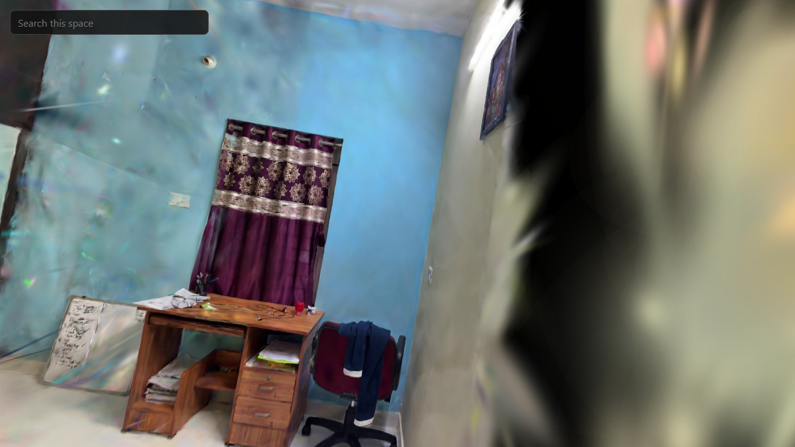
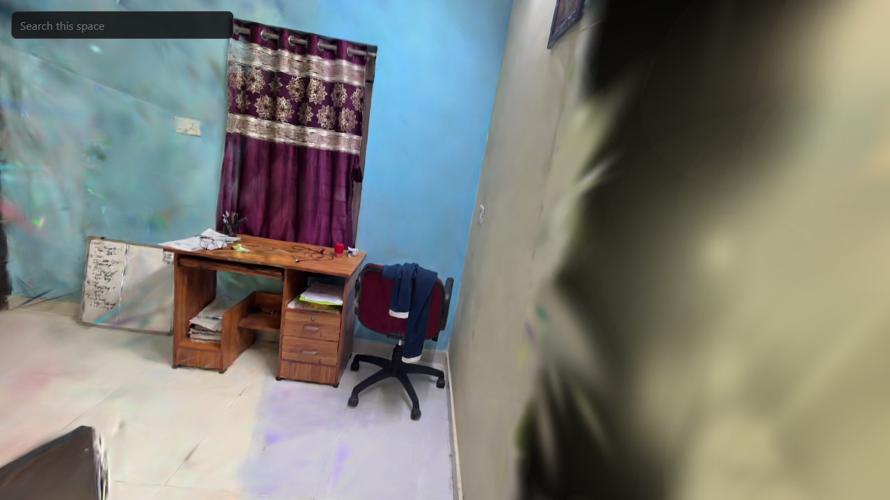
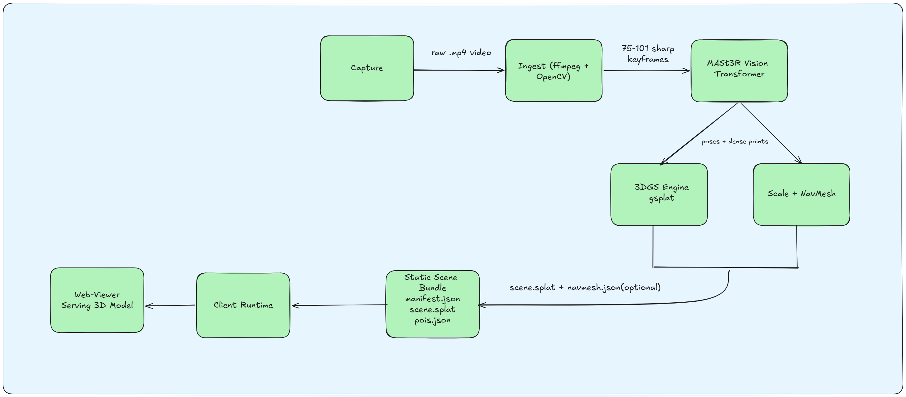
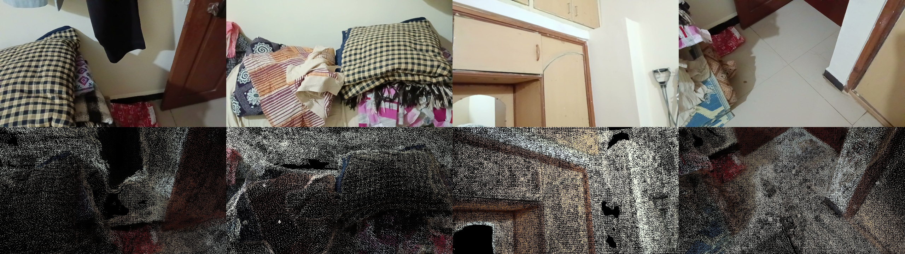
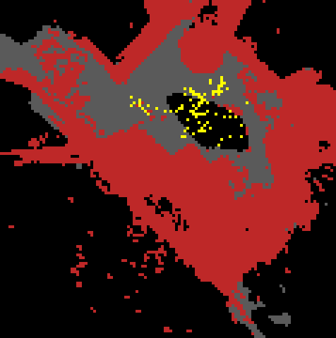
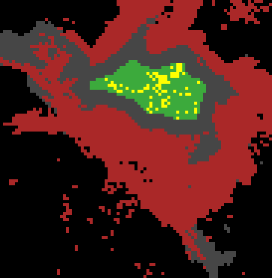

# AtomSpace

Turns a smartphone video of an indoor space into a photorealistic 3D web scene you can walk through in first person, from any browser. No depth sensor, scanning rig or app install is needed.

**[Try the live demo](https://atomspace-deploy.vercel.app/?scene=friendroom-r30)** (about 35 MB; WASD and mouse on a laptop, touch controls on a phone)

| Level view | Tilted-down view |
|---|---|
|  |  |

*The submitted room in the web viewer: 1.08M Gaussians in a 33 MB file.*

## How it works



1. **Ingest:** ffmpeg extracts frames, OpenCV drops blurred and near-duplicate ones.
2. **Reconstruct:** MASt3R-SfM estimates camera poses and dense 3D points from a sparse graph of image pairs, including loop-closure pairs. COLMAP isn't used.
3. **Splat:** gsplat trains 3D Gaussians for 30,000 steps, seeded from the dense points.
4. **Compress:** the model becomes a 32-byte-per-Gaussian `.splat`, without near-transparent and needle-shaped Gaussians.
5. **Scale and navmesh:** the user gives one real distance, then a Python builder turns the dense points into walkable floor polygons with a 0.25 m buffer around obstacles.
6. **Bundle and view:** static files are validated against `schemas/`, and the Three.js viewer renders them in the browser with [gaussian-splats-3d](https://github.com/mkkellogg/GaussianSplats3D).

Loop closure is what removes drift. Below, each real frame (top) sits above the generated point cloud projected into the same view (bottom):



The navmesh comes from an occupancy grid of those dense points. These are from the test room at a trial scale:

| Occupancy grid | Navmesh |
|---|---|
|  |  |

More detail: [docs/architecture.md](docs/architecture.md) and [docs/file_structure.md](docs/file_structure.md).

## Status

Built for a hackathon. Capture, reconstruction and free roaming are complete.

| Feature | Status |
|---|---|
| Video to walkable splat in the browser | Working, used for the live demo |
| Laptop and phone controls | Working on the live demo; phones run it less smoothly |
| Scale tool, navmesh collision | Built and tested on the test room or synthetic data; not applied to the demo scene, so you can walk through its walls |
| POI search, fly-to and POI editor | Built and tested on synthetic data; the demo scene has no POIs |
| ARKit/LiDAR fast track | Designed, not implemented (`sensor_track.py` raises `NotImplementedError`) |
| Pathfinding, phone-camera AR navigation | Planned |

Measured on the test room (101 keyframes):

| Stage | Hardware | Time | Peak GPU memory |
|---|---|---|---|
| Ingest | Laptop | 25 s | None |
| Reconstruct, 735 pairs with loop pairs | RTX 2050, 4 GB | About 30 min | 4.41 GiB |
| Splat training, 30,000 steps | Google Colab T4 | 35 min | 0.94 GiB |

The 4 GB run was a minimal experiment outside this repository, using selected loop pairs. Its output was 2.2M Gaussians in 71 MB. The supported minimum is 8 GB.

## Setup

### Requirements

- **Viewer and CPU stages:** Node 20+, Python 3.10+, any modern browser.
- **GPU stages (`reconstruct`, `splat`):** an NVIDIA GPU from the RTX 20 series or newer with 8 GB+ VRAM, on WSL2 or Linux.

### Clone

```bash
sudo apt install -y git-lfs    # do this first, or large files arrive as small text pointers
git clone --recursive https://github.com/SoloBeing/NammaSpace.git AtomSpace
cd AtomSpace
```

The repository is named NammaSpace; the project and code are AtomSpace.

### GPU machine

Follow [env/README.md](env/README.md). In short:

```bash
bash env/setup_wsl.sh          # conda environment, ASMK, curope, gsplat
bash env/download_weights.sh   # about 3 GB; safe to interrupt and re-run
conda activate atomspace
python env/smoke_test.py
```

Naver's download server can be very slow (we saw 0.04 MB/s), so allow time for it.

`setup_wsl.sh` needs conda, so it doesn't work on Google Colab. There, gsplat installed with:

```bash
TORCH_CUDA_ARCH_LIST=7.5 MAX_JOBS=2 pip install --no-build-isolation git+https://github.com/nerfstudio-project/gsplat.git@v1.5.3
```

### Viewer

```bash
cd viewer
npm install
npm run dev
```

Open `http://localhost:5173/?scene=<name>`. Add `&admin` for the scale and POI tools, which only work on the dev server.

## Reconstruct the sample scene

[`test/testroom/frames/`](test/README.md) holds the 101 keyframes from our test room, so you can skip capture and ingest:

```bash
cp -r test/testroom/frames scenes/testroom/
atomspace reconstruct testroom
atomspace splat testroom
atomspace bundle testroom
cd viewer && npm install && npm run dev
```

Then open `http://localhost:5173/?scene=testroom`. `scenes/testroom/ingest.json` is already in the repository and lists the keyframes.

Expect the eye-level black band shown in our results: this capture was tilted down throughout, which is why the demo uses a different room.

## Reconstruct your own space

Walk the room slowly in layered loops at different heights, finish where you started, and add close-ups of important objects. Use 1080p, with HDR, beauty modes and heavy stabilisation turned off.

```bash
atomspace run myroom path/to/video.mp4   # ingest, reconstruct, splat, bundle

# optional: metric scale, then collision
atomspace scale myroom --a 0.1 0.0 2.3 --b 0.1 1.1 2.3 --distance 2.0
atomspace navmesh myroom && atomspace bundle myroom
```

`--a` and `--b` are two points in reconstruction space, and `--distance` is their real separation in metres. The viewer's scale tool (`&admin`) picks them by clicking. Each stage reruns on its own: `atomspace {ingest,reconstruct,splat,scale,navmesh,bundle} <scene>`.

## Controls

| Action | Laptop | Phone |
|---|---|---|
| Walk | W A S D | Left thumb |
| Look | Click the scene, then move the mouse | Right thumb |
| Free the cursor | Esc | Not needed |

## Deploy

The viewer is static, so any static host works, and no special headers are needed.

```bash
cd viewer && npm run build
```

Serve `viewer/dist/` with each scene at `/scenes/<name>/bundle/`, or set `VITE_SCENES_BASE_URL` at build time to host scenes elsewhere. Visitors need `?scene=<name>` in the URL.

## Tests

```bash
cd pipeline && pip install -e ".[dev]" && pytest -q     # 33 tests, no GPU needed
cd viewer && npx tsc --noEmit && npx vitest run         # 9 tests
```

## License

AtomSpace's own code is under the [MIT License](LICENSE).

**MASt3R, DUSt3R and CroCo, including their weights, are CC BY-NC-SA 4.0, so using this pipeline to reconstruct a scene is non-commercial only**, whatever the license on our code. See [THIRD_PARTY_NOTICES.md](THIRD_PARTY_NOTICES.md), which also covers the images and sample data.
